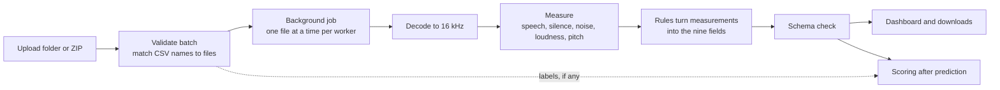

# AudioEval: Deliverables and Reviewer Guide

AudioEval analyzes recorded customer calls for **emotional tone**, **background noise**,
and **technical audio problems**. For every audio file it returns the same nine-field JSON
result. Reviewers upload a batch in a browser dashboard, watch it process, inspect the
results, and download them. The same analysis also runs from the command line.

This guide is meant to be shared. It covers:

1. [What was delivered and its status](#at-a-glance)
2. [How the analysis works](#how-it-works)
3. [User walkthrough](#user-walkthrough) of the dashboard, with a command-line fallback
4. [Deliverable details](#deliverable-details), with evidence for each item
5. [How I approached this assignment](#how-i-approached-this-assignment) as a game developer new to robotics and ML

> **Confidentiality.** The trial brief and the supplied call audio are confidential.
> This repository contains no audio, labels, or credentials; keep it private unless
> AutoAce approves publication.

## At a glance

| # | Deliverable | Status | Evidence |
| --- | --- | --- | --- |
| 1 | Hosted dashboard with login | Built and tested locally. **Not deployed yet.** | [web.py](../audioeval/web.py), [README deployment](../README.md#deployment) |
| 2 | Runnable implementation | Done | [README.md](../README.md), [MODEL_SETUP.md](MODEL_SETUP.md) |
| 3 | Batch upload workflow | Done | [batch.py](../audioeval/batch.py), [jobs.py](../audioeval/jobs.py) |
| 4 | Predictions for the supplied calls | Done | [supplied_calls.csv](../predictions/supplied_calls.csv) |
| 5 | Technical memo and architecture | Done | [TECHNICAL_MEMO.md](TECHNICAL_MEMO.md) |
| 6 | Validation and confusion matrix | Done; descriptive only (three calls) | [validation.md](../reports/validation.md) |
| 7 | Cost per audio minute | Measured locally; host price is an assumption | [cost_latency.md](../reports/cost_latency.md) |
| 8 | Latency | Measured locally | [cost_latency.md](../reports/cost_latency.md) |
| 9 | Limitations and next steps | Done | [Limitations](#9-limitations-and-next-steps) |

Key facts:

- **Default method:** a deterministic acoustic baseline (E0). It uses no trained models,
  so every output can be traced to a measurement. Optional local models were tested but
  are not enabled by default.
- **Speed:** a real-time factor (RTF) of about 0.007. One minute of audio takes about
  0.4 seconds on an 8-core desktop CPU.
- **Cost:** about $0.00006 per audio minute at an assumed $0.05 per instance-hour and 10%
  utilization. The required ceiling is $0.003.
- **Accuracy:** tone matched 1 of 3 supplied calls. Three calls cannot show how the system
  performs on new audio, and the reports say so.
- **Quality checks:** 54 automated tests run on synthetic audio, and the code passes lint.
- **Main open item:** hosting. The service still needs a URL, HTTPS, and evaluator
  credentials delivered privately.

## How it works



1. **Validate.** Audio filenames are matched exactly to the `name` column of the CSV
   manifest. Missing files, duplicates, unsupported formats, and bad CSV rows are reported
   with clear messages instead of being guessed.
2. **Decode.** Each file is converted to 16 kHz. Identical stereo channels count as mono.
3. **Measure.** The audio is cut into 10 ms frames. Speech is separated from non-speech,
   then loudness, pitch movement, background energy, clicks, clipping, and silence gaps
   are measured.
4. **Decide.** Readable rules with configurable thresholds turn the measurements into the
   nine fields. Each field records its evidence and a confidence.
5. **Check.** Every result is validated against the required schema. A file that fails
   gets an error message, not a made-up prediction.
6. **Score (optional).** If the CSV contains expected results, they are compared only
   after prediction. Labels never reach the analysis.

The nine fields are emotional tone, emotional intensity, background noise present, noise
type, noise severity, audio quality, speaker overlap, long silence, and confidence. See
[schema.py](../audioeval/schema.py) for the allowed values.

## User walkthrough

### Before you start

- **Access.** Once the service is deployed, the URL and a dedicated evaluator account are
  sent privately. Until then, run it locally with the commands in
  [README: Run locally](../README.md#run-locally); it opens at `http://127.0.0.1:8000`.
- **Prepare a batch.** Use a folder or ZIP with audio files at the top level and one CSV
  manifest. The CSV can have any name.

  ```
  evaluation_batch/
    call_001.wav
    call_002.mp3
    labels.csv        # columns: name, result_json (result_json is optional)
  ```

  WAV, MP3, OGG (Vorbis/Opus), and FLAC always work. M4A, AAC, WMA, WebM, and AMR need
  `ffmpeg` on the server. A single wrapper folder inside a ZIP is fine, and several ZIPs
  can be uploaded together as one batch.

### Step 1: Sign in

Open the URL, then enter your username and password and select **Sign in**. After five
failed attempts, sign-in is blocked for 15 minutes. A session lasts up to 8 hours.

### Step 2: Choose the batch

Select **Choose folder** for a folder, or **Choose ZIP or files** for one or more ZIPs or
loose files. You can also drag files onto the drop area. The line next to the buttons
shows how many ZIP, CSV, and other files you selected.

### Step 3: Upload and analyze

Select **Upload and analyze**. A progress bar shows the upload. Analysis then runs in the
background. You can leave the page and reopen the batch later from **Previous batches**.

### Step 4: Read the validation messages

Messages appear under the batch progress bar:

- **Errors** are batch-level problems, such as more than one CSV or no usable audio. If
  nothing can be processed, the batch is marked *invalid*.
- **Warnings** do not stop processing. For example, an audio file that is not in the
  manifest is still analyzed, and a manifest without `result_json` is treated as unlabeled.
- **Skipped** lists system files (such as `.DS_Store` and `__MACOSX`) and files inside
  nested folders.

Problems with individual files appear on that file's row, such as "listed in manifest
but not found" or "could not decode audio". One bad file never stops the rest.

### Step 5: Watch progress

The status badge moves from *running* to *completed* or *completed with errors*. The
summary line shows files processed, audio minutes, real-time factor, and the manifest
name. The page refreshes every 1.5 seconds while the batch runs.

### Step 6: Review the Overview tab

- **Metric cards:** files completed, audio minutes analyzed, processing time, and an
  estimated compute cost.
- **Cost estimate assumptions:** change the hourly price and utilization to recalculate
  the cost in your browser. The default values are illustrative, not a provider quote.
- **Prediction breakdown:** how many files fell into each tone, intensity, noise, noise
  type, quality, and overlap value.
- **Confidence distribution:** a heuristic score, not a calibrated probability.
- **Agreement with supplied labels:** appears only when the CSV includes expected results.
  It shows accuracy and macro F1 for each field. With only a few files, these numbers say
  little about how the system performs on new audio.

### Step 7: Review the File results tab

The table shows one row per file with its status, duration, the nine fields, and
estimated compute cost. Use **Filter files** to show *Failed*, *Completed*, *Label
mismatches*, or *With warnings*. When a prediction differs from the supplied label, the
cell is highlighted and shows `expected: …` underneath.

### Step 8: Download results

Open **Download results** and choose a file:

| File | Contents |
| --- | --- |
| Predictions CSV | `name,result_json` for successful files: the required output format |
| Full results JSON | Everything: predictions, per-field confidence, evidence, timings, and scores |
| Errors CSV | Failed files and any warnings |

### Step 9: Come back later or sign out

Reopen any earlier batch from **Previous batches**. If the server restarts during a
batch, the batch shows as *interrupted* and a **Resume** button appears. Raw audio is
deleted when a batch finishes, and batches are deleted after 72 hours. Select
**Sign out** when you are done.

### Fallback: command line

If the hosted dashboard is unavailable, the CLI produces the same three files:

```powershell
.\.venv\Scripts\python.exe -m audioeval analyze "path\to\batch.zip" --out output
.\.venv\Scripts\python.exe -m audioeval evaluate --predictions output\predictions.csv --labels path\to\labels.csv
```

The saved [validation report](../reports/validation.md) and
[baseline predictions](../predictions/supplied_calls.csv) can also be reviewed directly.

### Troubleshooting

| What you see | Likely cause | What to do |
| --- | --- | --- |
| "too many failed attempts" | Five failed sign-ins within 15 minutes | Wait 15 minutes |
| "multiple CSV files at batch root" | More than one CSV in the batch | Keep only the manifest |
| "listed in manifest but not found" | Names must match exactly, including extension and case | Rename the file or the CSV row; the error suggests a similar name if one exists |
| "unsupported file type" | Format needs `ffmpeg`, or the file is not audio | Install `ffmpeg` on the server or convert the file to WAV |
| "upload larger than … MB" | Upload size limit (`AUDIOEVAL_MAX_UPLOAD_MB`) | Split into smaller batches or raise the limit |
| Batch shows *interrupted* | Server restarted during processing | Select **Resume**; re-upload if the audio was already removed |
| Signed out unexpectedly | Session expired, or the secret key changed on restart | Sign in again; set a stable `AUDIOEVAL_SECRET_KEY` |

## Deliverable details

### 1. Hosted dashboard and login

The application provides an authenticated dashboard and a JSON job API. Sign-in uses
PBKDF2-hashed passwords, login rate limiting, signed session cookies, and CSRF tokens.
Users see only their own batches.

**The service is not hosted yet.** Before evaluation: build and deploy the container,
configure HTTPS and persistent storage, set the secrets, verify sign-in, and keep one
instance running for the evaluation period. Then send the URL and credentials through a
private channel; never commit them. Host requirements and an example Azure Container Apps
setup are in the [README deployment section](../README.md#deployment). Code:
[auth.py](../audioeval/auth.py) and [web.py](../audioeval/web.py).

### 2. Runnable implementation

The repository includes Windows setup steps, a CLI for analysis, scoring, benchmarking,
and cost, environment-based configuration, and a Dockerfile. All inference is local;
call audio is never sent to an external service.

The Docker image has not been built yet (Docker was unavailable on the build machine), so
a clean-machine setup and a deployment smoke test are still needed. See
[README.md](../README.md), [MODEL_SETUP.md](MODEL_SETUP.md), and
[config.py](../audioeval/config.py).

### 3. Batch upload workflow

The dashboard accepts a folder, one ZIP, or several ZIPs as one batch. It validates the
manifest and filename mapping, reports errors and warnings, processes each file
independently, and offers predictions, errors, and full JSON results for download. A
failed file does not stop other files.

Code: [batch.py](../audioeval/batch.py), [jobs.py](../audioeval/jobs.py),
[web.py](../audioeval/web.py), and [export.py](../audioeval/export.py). Tests:
[test_batch.py](../tests/test_batch.py), [test_web.py](../tests/test_web.py), and
[test_schema.py](../tests/test_schema.py).

### 4. Predictions for supplied calls

Each successful file produces exactly the nine required fields. Allowed values and
consistency rules (for example, no noise means an empty noise type and severity `none`)
are enforced in [schema.py](../audioeval/schema.py).

Baseline predictions are in [supplied_calls.csv](../predictions/supplied_calls.csv) and
summarized in the [validation report](../reports/validation.md):

| File | Tone | Intensity | Noise | Noise type | Severity | Quality | Overlap | Long silence | Confidence |
|---|---|---|---|---|---|---|---|---|---:|
| call_001.ogg | neutral | medium | false | — | none | clear | false | false | 0.635 |
| call_002.ogg | neutral | medium | false | — | none | clear | true | false | 0.606 |
| call_003.ogg | neutral | medium | true | static | medium | clear | false | false | 0.617 |

Predictions were made without access to the labels; scoring ran afterwards.

### 5. Technical memo and selected architecture

The [technical memo](TECHNICAL_MEMO.md) compares six configurations:

| ID | Configuration | Outcome on the three supplied calls |
| --- | --- | --- |
| E0 | Acoustic features and rules | **Selected default.** Cheapest; tone 1/3 |
| E1 | E0 + AudioSet event tagging | Found the TV noise, but with the wrong type and severity |
| E2 | E0 + speech emotion recognition | Fixed one upset call, but mislabeled a neutral call as upset |
| E3 | E0 + Whisper-small + text emotion | No overall change |
| E4 | E1 + E2 + E3 (full fusion) | No tone gain; close to the cost ceiling at 10% utilization |
| E6 | E4 with Whisper-base | Same predictions as E4, faster |

E5, a gated overlap model, was not run because access was not available. Three calls
are too few to choose or calibrate a model, so the inexpensive and explainable baseline
stays the default. Model setup and reproduction steps are in
[MODEL_SETUP.md](MODEL_SETUP.md).

### 6. Validation

The [validation report](../reports/validation.md) covers the three supplied calls and the
synthetic tests. For baseline tone, accuracy is **1/3 (0.333)** and macro F1 is
**0.167**. The report includes per-class results and a five-class tone confusion matrix.
Only neutral, satisfied, and upset appear in the labels, one example each, and the
baseline predicts neutral for all three.

These results describe agreement on three examples. They are **not evidence of how the
system performs on new audio.** Some thresholds were chosen with these calls in view,
and several classes have no examples. Independent labeled data and a grouped holdout
are needed before making accuracy or calibration claims.

### 7–8. Cost and latency

The [cost and latency report](../reports/cost_latency.md) uses local CPU measurements on
an AMD Ryzen 7 5800XT and an **assumed** compute price of **$0.05 per instance-hour**
(not a provider quote). The baseline E0 measured **0.0070 RTF** (processing time divided
by audio duration); E6 measured **0.2527 RTF**.

At 10% utilization the estimates are **$0.0000583 per audio minute for E0** and
**$0.0021058 for E6**, against the $0.003 ceiling. They exclude idle hosting, storage,
egress, and monitoring. Cost and latency on the real deployment are still unverified
because they depend on the host, workload, and utilization.

### 9. Limitations and next steps

Known limitations:

- Tone is weak. Without a model, the baseline cannot tell positive from negative emotion,
  and the tested models did not help on the supplied calls.
- Noise that plays under continuous speech, such as a TV, is missed by the baseline.
- Overlap detection on single-channel audio is unreliable, so its confidence is capped.
- Customer and agent are not separated on mono or dual-mono audio.
- Confidence is a heuristic, not a calibrated probability.
- The text emotion model is English-only, and echo, robotic audio, and codec artifacts
  are not yet measured.

Recommended next steps:

1. Build and test the Docker image, then deploy over HTTPS with persistent job storage.
2. Send an evaluator account through an approved private channel and verify the hosted
   workflow end to end.
3. Obtain approved, independently labeled calls covering all tone classes and common
   noise conditions, and evaluate on a grouped holdout.
4. Measure latency and cost on the real deployment at the expected workload.
5. Revisit model selection and calibrate confidence on that independent data.
6. Confirm data-retention, model-license, and recording approvals before production use.

Requirements and the full verification checklist are in [PLAN.md](../PLAN.md). The
runbook is [README.md](../README.md).

## How I approached this assignment

I come from game development, with little background in robotics or machine learning.
This section describes how I worked through the assignment in three days, what carried
over from games, what I had to learn, and what I would do differently.

I treated the task like a robot perception problem, which helped me break it down. A
noisy sensor (a microphone) produces measurements, the measurements become decisions
with a confidence, and the whole thing has to fit a compute budget. That shape also
looked familiar from game audio and gameplay systems.

### What carried over from game development

| Game development | Where I used it here |
| --- | --- |
| Game audio: decibels, sample rates, mixing, level meters | Loudness, signal-to-noise ratio, clipping, and silence detection |
| Frame budgets and profiling | Real-time factor and cost per audio minute; the 10 ms analysis frames work like a fixed tick |
| Asset and build pipelines | Batch ingestion, validation, and reproducible exports |
| State machines and tuning tables | Rule-based decisions with thresholds kept in one config file |
| Tools and UI work | The upload dashboard |
| Bug triage | Explaining each wrong prediction from its measured evidence |

### What I had to learn

I kept the list short and learned each topic only as far as the task needed:

- **Evaluation:** accuracy versus macro F1, confusion matrices, why three examples cannot
  validate a model, and why labels must never reach the analysis.
- **Speech signal basics:** voice activity detection, pitch from autocorrelation, and
  spectral flatness (how noise-like a sound is).
- **Pretrained models:** downloading a pinned version from Hugging Face, mapping its
  labels to the required ones, and running it offline.
- **Web security for uploads:** password hashing, CSRF tokens, safe ZIP extraction, and
  login rate limiting.
- **Cost modeling:** hourly price divided by the audio minutes processed per hour.

I deliberately skipped training a model, because there were only three labeled calls. I
also skipped robotics frameworks, GPUs, and microservices, none of which the task needed.

### How the three days went

**How I used AI tools.** I used an AI coding assistant the way I would expect to on a
small, fast-moving team: to move faster, not to replace my judgment.

- **What I used it for:** scaffolding, boilerplate, first drafts of tests and docs, and
  quick explanations of unfamiliar topics such as macro F1 or voice activity detection.
- **What I decided myself:** the requirements and plan, the choice of a rule-based
  baseline, keeping labels out of the analysis, which model results to trust, and what
  to claim in the reports.
- **How I checked the output:** automated tests, a linter, and real runs on the supplied
  calls. Every number in the reports comes from a measured run, not from generated text.
- **Where I took extra care:** I reviewed security-sensitive code myself, which is how I
  found and fixed the rate-limiting issue described under Day 2.
- **Data handling:** the confidential call audio stayed on my machine and out of the
  repository, and all model inference runs locally.
- **Ownership:** I did a cleanup pass before submitting, and I can explain and maintain
  any part of the code.

**Day 1: requirements and a complete first version**

- I started by turning the brief into [PLAN.md](../PLAN.md): the nine-field contract,
  acceptance criteria for each requirement, the deliverables checklist, and a list of
  open questions for AutoAce (deadline, hosting, data handling, and how to identify the
  customer).
- I checked the three calls' file headers before writing analysis code. They are Ogg
  Opus, 48 kHz, and two channels, but the two channels are identical, so customer and
  agent cannot be separated by channel. I also noted gaps in the labels: no frustrated or
  distressed examples, no long silences, no impaired audio, and static labeled as
  background noise rather than audio quality.
- I chose explainable acoustic rules as the baseline instead of a trained model, and
  locked down the output schema first, the way I would fix a save-file format.
- By the end of the day the first version covered the whole path: decoding, features,
  rules, batch validation, background jobs, the dashboard with sign-in, the CLI, tests on
  synthetic audio, and first-draft reports.

**Day 2: model experiments and a security review**

- I downloaded pinned versions of four pretrained models (speech emotion, sound events,
  Whisper transcription, and text emotion) and ran six configurations (E0 to E4, and E6)
  against the three calls. I recorded accuracy, speed, and cost for each in the
  [validation](../reports/validation.md) and [cost](../reports/cost_latency.md) reports.
- None of the models improved tone overall. Speech emotion fixed one call and broke
  another. I kept the cheap, explainable baseline as the default and reported the
  results as observations on three calls, not validation.
- I reviewed the security of the hosted path. One fix came out of it: login rate
  limiting trusted a header that a client can fake (`X-Forwarded-For`), so I changed it to
  read only the address added by the hosting proxy and added a test for it.

**Day 3: dashboard, cleanup, and write-up**

- I reworked the dashboard so reviewers get an overview with charts and cost estimates,
  plus a separate file-results table with filters and label comparisons.
- I did a cleanup pass on the AI-generated code (see the checklist below) and made sure
  every document agreed with the code and the measurements.
- I wrote this guide and the user walkthrough.

### What did not get done

The app is not deployed. Docker was not available on my machine, so the container image
was never built, and I had no approved host or account to deploy to. Everything else is
ready for deployment, and the [README](../README.md#deployment) lists the steps.

### Cleaning up AI-generated code

Before submitting, I reviewed the generated code for problems that tests and linters do
not catch on their own:

- **Comments and docs must match the code.** One comment claimed the thresholds were not
  chosen with the supplied calls in view, which contradicted the validation report. I
  corrected it.
- **Tests must check what their names say.** A test called "label independence" only ran
  the same file twice. It now runs identical audio with different labels and requires
  identical predictions.
- **Every limit must apply on every code path.** The maximum audio length was not checked
  for files decoded through `ffmpeg`. It is now.
- **Small tidy-ups:** no imports of private names across modules, no unneeded inline
  imports, and no unused variables.
- **Repeatable checks:** I committed a lint configuration; `ruff check .` and all 54
  tests pass.
- **Honest status:** the verification checklist in [PLAN.md](../PLAN.md) marks only what
  tests or recorded runs actually cover.

### What I would do differently

| Lesson | Why |
| --- | --- |
| Start deployment on day 1 | It is the main thing left open. Hosting depends on access and approvals that take time to arrange |
| Ask for more labeled calls immediately | Three calls cannot tell me whether a change helps, so model choices stayed guesses |
| Do a listening review of each call early | It is still listed as pending in the plan. Hearing the calls would show who the customer is and where the noise sits, which the measurements alone cannot |
| Review AI output in small batches | Reviewing a large generated first version at the end took longer than reviewing it as it was written |

### What I would tell another newcomer

In three days you can build a working, well-tested, and honestly documented pipeline and
dashboard without an ML background. Do not expect strong emotion accuracy from three
labeled calls. After the first version, more labeled data will improve accuracy more
than more code will.