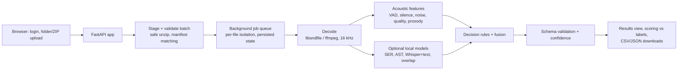

# Technical Memo: Voice Tone and Background Noise Analysis

## Summary

AudioEval is a hosted-ready web service and CLI that analyzes call audio and returns the
required nine-field JSON for each clip. It has two layers:

1. A **deterministic acoustic baseline** (implemented, tested, measured) that handles
   silence, technical quality, impulsive/sustained background noise, two-channel overlap,
   and emotional intensity from prosody.
2. **Optional local models** (adapters implemented, not yet run): speech emotion
   recognition, transcript emotion, AudioSet event tagging, and overlap detection. They
   fill the baseline's known gaps, mainly valence and noise under speech.

All processing is local. No external API is used and no call audio leaves the host.

## Approaches tested

| Approach | Status | Result |
| --- | --- | --- |
| A. Acoustic features + rules (E0) | Implemented and measured | RTF 0.0046; tone 1/3 (always neutral), noise 2/3, quality 3/3, overlap 2/3, silence 3/3 on the supplied calls |
| B. Pretrained audio models (SER + AST + optional overlap) | Code ready, weights not downloaded | Not measured |
| C. ASR + transcript emotion, fused with B | Code ready, weights not downloaded | Not measured |

The brief asks for at least two materially different approaches. A is complete; B and C
are the second and third and must be run before submission (see [MODEL_SETUP.md](MODEL_SETUP.md)).
A trivial majority-class predictor is equivalent to A's tone output on these calls.

## Final architecture

Key choices:

- **Rules on interpretable features first.** Cheap, reproducible, and explains each output
  (`details.evidence` in `results.json`). Learned models are added only where features
  cannot answer (valence, noise identity).
- **Labels are never inference input.** Scoring runs after prediction, in a separate module.
- **Per-file isolation.** A corrupt or unsupported file fails alone with a reason.
- **Offline models.** `HF_HUB_OFFLINE=1`; models load only from local directories.

## How ambiguous cases are handled (brief section 9)

- **Ambiguous tone**: `neutral` unless a non-neutral class reaches 0.35 aggregated
  probability and beats neutral. Without valence evidence the output is `neutral` with
  low confidence (0.35). Loudness alone raises intensity, never tone.
- **Mixed customer and agent speech**: when channels are not separable, tone uses the mean
  of all windows blended with the most emotional 25%, so short customer emotion is not
  diluted by a calm agent.
- **Low-level background noise**: noise counts only if it is active in at least 15% of
  background frames, or produces at least 6 impulsive events per minute, or the
  speech-to-background ratio is under 15 dB. At least 3 s of non-speech audio is needed to
  decide; otherwise confidence is capped at 0.5. Barely perceptible artifacts do not count.
- **Static**: treated as background noise, not audio quality, following the supplied label
  for `call_003`. This is an open question for AutoAce.
- **Long silence**: at least 10 s without speech (configurable; the brief gives no number).

## Confidence calibration

The overall confidence is the geometric mean of per-field heuristic confidences. It is not
calibrated, because calibration needs independent labeled data. An isotonic calibrator is
implemented (`python -m audioeval calibrate`, at least 30 clips) with a declared correctness
event: tone, noise presence, and audio quality all correct. It must be checked on a
separate held-out set before use.

## Validation, cost, latency

- Validation: [reports/validation.md](../reports/validation.md). Three clips are fixtures, not
  validation; results are descriptive.
- Cost and latency: [reports/cost_latency.md](../reports/cost_latency.md). Baseline RTF 0.0046
  on a desktop CPU, well under $0.003 per audio minute on any reasonable instance.

## Failure modes and limitations

- Tone is effectively unsupported until models are added.
- Noise under continuous speech (TV, music) is missed by the baseline.
- Single-channel overlap detection is weak (confidence capped at 0.6).
- Customer and agent are not separated on mono or dual-mono audio.
- Echo, robotic audio, and codec artifacts are not measured by the baseline quality rules.
- Thresholds were set with knowledge of the three supplied calls; generalization is unknown.
- Text emotion models are English; other languages need a different text model.
- Confidence is uncalibrated.

## Next steps for accuracy

1. Download models and run E1-E6 ([MODEL_SETUP.md](MODEL_SETUP.md)); pick the best
   configuration under the cost ceiling.
2. Obtain approved labeled calls covering all five tones and more noise types; build a
   grouped (by caller/call) validation split; tune thresholds and the text weight there.
3. Calibrate confidence on that data.
4. Add diarization or use stereo recordings to analyze only the customer.

## Path to production integration

- **Interface**: the same JSON API the dashboard uses (`POST /api/jobs`,
  `GET /api/jobs/{id}`, downloads). Next step: service accounts with API tokens and a
  webhook or storage-triggered batch (drop files into a bucket, results written back).
- **Hosting**: one container (Dockerfile provided). Scale out by running more instances
  behind a load balancer with shared job storage, or move the job queue to a managed queue.
- **Data handling**: raw audio is deleted after each job by default; results expire after
  72 hours (configurable). Logs contain job IDs and counts, not audio or transcripts.
- **Operations**: `/healthz` and `/readyz` probes; per-job processing time and real-time
  factor in results; versioned method name in every result for traceability.

## External services disclosure

None. All inference runs on the host. Model weights are downloaded once from Hugging Face
on a separate machine; no call audio is uploaded anywhere.
