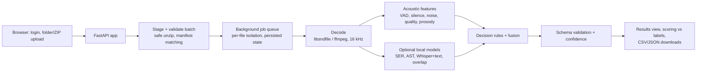

# Technical Memo: Voice Tone and Background Noise Analysis

## Summary

AudioEval is a hosted-ready web service and CLI that analyzes call audio and returns the
required nine-field JSON for each clip. It has two layers:

1. A **deterministic acoustic baseline** (implemented, tested, measured) that handles
   silence, technical quality, impulsive/sustained background noise, two-channel overlap,
   and emotional intensity from prosody.
2. **Optional local models** (pinned weights downloaded and E1-E4/E6 executed):
   speech emotion recognition, transcript emotion, AudioSet event tagging, and a gated
   overlap detector. They address valence and noise under speech, with limited fixture
   improvements so far.

Inference is local; no external inference API is used and no call audio leaves the host.
The model files were downloaded from Hugging Face at immutable revisions listed in
[MODEL_SETUP.md](MODEL_SETUP.md).

## Approaches tested

| Approach | Status | Result on the three supplied fixtures |
| --- | --- | --- |
| A. Acoustic features + rules (E0) | Implemented and measured | RTF 0.0070; tone accuracy 1/3, macro F1 0.167; noise presence 2/3 |
| B. AudioSet events (E1) | Downloaded, loaded, and measured | RTF 0.0763; tone unchanged; noise presence 3/3, but call_002 type/severity were wrong |
| C. Speech emotion (E2) | Downloaded, loaded, and measured | RTF 0.0669; tone accuracy 1/3, macro F1 0.222; one corrected upset and one false upset |
| D. Whisper-small + GoEmotions (E3) | Downloaded, loaded, and measured | RTF 0.1592; no aggregate fixture accuracy gain |
| E. Full fusion (E4) | Downloaded, loaded, and measured | RTF 0.3595; no tone gain; only noise-presence fixture gain |
| F. Full fusion + Whisper-base (E6) | Downloaded, loaded, and measured | RTF 0.2527; same fixture predictions as E4 |

These are descriptive fixture comparisons, not generalization results: only three calls
are labeled, classes are missing, and model choices were not tuned on independent data.
Keep the baseline as the default. Do not select or calibrate a model from these three
examples; first obtain an approved grouped holdout. E5 remains unrun because its model is
gated.

## Final architecture

Key choices:

- **Rules on interpretable features first.** Cheap, reproducible, and explains each output
  (`details.evidence` in `results.json`). Learned models are added only where features
  cannot answer (valence, noise identity).
- **Labels are never inference input.** Scoring runs after prediction, in a separate module.
- **Per-file isolation.** A corrupt or unsupported file fails alone with a reason.
- **Offline models.** `HF_HUB_OFFLINE=1`; models load only from local directories.

## How ambiguous cases are handled (brief section 9)

- **Ambiguous tone**: `neutral` unless a non-neutral class reaches 0.35 aggregated
  probability and beats neutral. Without valence evidence the output is `neutral` with
  low confidence (0.35). Loudness alone raises intensity, never tone.
- **Mixed customer and agent speech**: when channels are not separable, tone uses the mean
  of all windows blended with the most emotional 25%, so short customer emotion is not
  diluted by a calm agent.
- **Low-level background noise**: noise counts only if it is active in at least 15% of
  background frames, or produces at least 6 impulsive events per minute, or the
  speech-to-background ratio is under 15 dB. At least 3 s of non-speech audio is needed to
  decide; otherwise confidence is capped at 0.5. Barely perceptible artifacts do not count.
- **Static**: treated as background noise, not audio quality, following the supplied label
  for `call_003`. This is an open question for AutoAce.
- **Long silence**: at least 10 s without speech (configurable; the brief gives no number).

## Confidence calibration

The overall confidence is the geometric mean of per-field heuristic confidences. It is not
calibrated, because calibration needs independent labeled data. An isotonic calibrator is
implemented (`python -m audioeval calibrate`, at least 30 clips) with a declared correctness
event: tone, noise presence, and audio quality all correct. It must be checked on a
separate held-out set before use.

## Validation, cost, latency

- Validation: [reports/validation.md](../reports/validation.md). Three clips are fixtures, not
  validation; results are descriptive.
- Cost and latency: [reports/cost_latency.md](../reports/cost_latency.md). E0 RTF 0.0070
  and E6 RTF 0.2527 on the local CPU; costs use a $0.05/hour assumption, not a host quote.
  At 10% utilization E6 estimates to $0.002106/audio-minute; at 2% it exceeds the ceiling.

## Failure modes and limitations

- Tone remains weak: model additions did not improve full-fusion accuracy on these fixtures.
- Noise under continuous speech (TV, music) is missed by the baseline.
- Single-channel overlap detection is weak (confidence capped at 0.6).
- Customer and agent are not separated on mono or dual-mono audio.
- Echo, robotic audio, and codec artifacts are not measured by the baseline quality rules.
- Thresholds were set with knowledge of the three supplied calls; generalization is unknown.
- Text emotion models are English; other languages need a different text model.
- Confidence is uncalibrated.

## Next steps for accuracy

1. Obtain approved labeled calls covering all five tones and more noise types; build a
   grouped (by caller/call) validation split; tune thresholds and the text weight there.
2. Measure the selected candidates on the target host at expected utilization; choose a
   configuration only if it improves held-out quality and meets the cost ceiling with margin.
3. Calibrate confidence on independent data.
4. Add diarization or use stereo recordings to analyze only the customer; run E5 only if
   its gated model access and license are approved.

## Path to production integration

- **Interface**: the same JSON API the dashboard uses (`POST /api/jobs`,
  `GET /api/jobs/{id}`, downloads). Next step: service accounts with API tokens and a
  webhook or storage-triggered batch (drop files into a bucket, results written back).
- **Hosting**: one container (Dockerfile provided). Scale out by running more instances
  behind a load balancer with shared job storage, or move the job queue to a managed queue.
- **Data handling**: raw audio is deleted after each job by default; results expire after
  72 hours (configurable). Logs contain job IDs and counts, not audio or transcripts.
- **Operations**: `/healthz` and `/readyz` probes; per-job processing time and real-time
  factor in results; versioned method name in every result for traceability.

## External services disclosure

No paid inference API is used. The pinned public model weights were downloaded from
Hugging Face to local, git-ignored directories; inference runs on this host and supplied
call audio is not uploaded to Hugging Face or another service. The $0.05/hour compute
price used in the reports is an estimate, not a provider quote. Confirm model-card terms
and deployment data-location requirements before production use.
